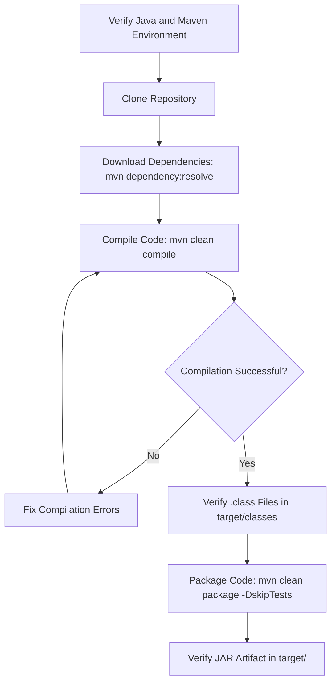

<!-- Add banner image here: save as assets/java-banner.png -->


# Java Code Compilation POC

---

## Author Table

| **Author** | **Created on** | **Version** | **Last edited on** | **L0 Reviewer**   | **L1 Reviewer** | **L2 Reviewer** |
| ---------- | -------------- | ----------- | ------------------ | ----------------- | --------------- | --------------- |
| Yogesh Singh | 10-10-26     | v1.0        | 10-10-26           | Anirudh / Liyakhat | Aman Raj       | Sandeep / Ravindra |

---

## Table of Contents

1. [Objective](#1-objective)
2. [Prerequisites](#2-prerequisites)
3. [Environment](#3-environment)
4. [Repository Setup](#4-repository-setup)
5. [Download Maven Dependencies](#5-download-maven-dependencies)
6. [Java Code Compilation](#6-java-code-compilation)
7. [Artifact Generation and Verification](#7-artifact-generation-and-verification)
8. [POC Workflow](#8-poc-workflow)
9. [POC Summary](#9-poc-summary)
10. [Final Result](#10-final-result)
11. [Conclusion](#11-conclusion)
12. [Contact Information](#12-contact-information)
13. [References](#13-references)

---

## 1. Objective

The objective of this POC is to verify that the `salary-api` Java project can be successfully compiled using Apache Maven and the Java compiler (`javac`).

This POC validates:

* Java and Maven environment availability.
* Repository setup.
* Dependency preparation.
* Successful Java source code compilation.
* Generated JAR artifact verification.

---

## 2. Prerequisites

The following prerequisites are required:

* Ubuntu 26.04 LTS system.
* Git installed.
* JDK already installed and configured.
* Apache Maven already installed and configured.
* Access to the `salary-api` repository.
* Internet access for downloading Maven dependencies.
* Sufficient disk space for dependencies and the generated JAR file.

---

## 3. Environment

| Component        | Details              |
| ---------------- | -------------------- |
| Operating System | Ubuntu 26.04 LTS     |
| Codename         | Resolute Raccoon     |
| Architecture     | Linux amd64          |
| Java Version     | `Java 17`      |
| Maven Version    | `Maven 3.8`    |
| Project          | `salary-api`     |

### Environment Verification

```bash
java -version
javac -version
mvn -version
cat /etc/os-release
```

<details>
<summary> Java, Maven and OS verification</summary>

<br>

<!-- environment-verification.png -->

</details>

---

## 4. Repository Setup

Clone the `salary-api` repository and navigate to the project directory:

```bash
git clone https://github.com/OT-MICROSERVICES/salary-api.git
cd salary-api
```

Verify the project files:

```bash
ls
```

<details>
<summary> Screenshot: Repository clone and project files</summary>

<br>

<!-- repository-clone.png -->


</details>

### Project Structure

<details>
<summary> Screenshot: Project structure</summary>

<br>

<!-- project-structure.png -->


</details>

---

## 5. Download Maven Dependencies

```bash
mvn dependency:resolve
```

<details>
<summary> Screenshot: Successful mvn dependency:resolve execution</summary>

<br>

<!-- dependency-resolve.png -->


</details>

---

## 6. Java Code Compilation

Run the compilation check:

```bash
mvn clean compile
```

The command removes old build output, then compiles the Java source files with `javac` into `target/classes`.

<details>
<summary> Screenshot: Successful mvn clean compile execution</summary>

<br>

<!-- mvn-clean-compile.png -->


</details>

### Verify the Compiled Classes

```bash
ls target/classes
```

<details>
<summary> Screenshot: Compiled .class files in target/classes</summary>

<br>

<!-- Add screenshot here: save as assets/06-compiled-classes.png -->


</details>

---

## 7. Artifact Generation and Verification

### Generate the JAR Artifact

```bash
mvn clean package -DskipTests
```

Tests are skipped because this POC validates compilation only.

<details>
<summary> Screenshot: Successful mvn clean package -DskipTests execution</summary>

<br>

<!-- Add screenshot here: save as assets/07-mvn-package.png -->


</details>

### Verify the JAR Artifact

```bash
ls -lh target/*.jar
```

<details>
<summary> Screenshot: JAR artifact verification</summary>

<br>

<!-- Add screenshot here: save as assets/08-jar-verification.png -->


</details>

---

## 8. POC Workflow



---

## 9. POC Summary

| Step                     | Command                                   | Result     |
| ------------------------ | ----------------------------------------- | ---------- |
| Environment Verification | `java -version` / `mvn -version`          | Verified   |
| Repository Setup         | `git clone`                               | Success    |
| Dependency Download      | `mvn dependency:resolve`                  | Success    |
| Compilation Check        | `mvn clean compile`                       | Success    |
| Artifact Creation        | `mvn clean package -DskipTests`           | Success    |
| Artifact Verification    | `ls -lh target/*.jar`                     | `<size>`   |

---

## 10. Final Result

The `salary-api` Java project was successfully compiled using Apache Maven and the Java compiler.

The POC verified:

* Java and Maven environment availability.
* Successful repository setup.
* Successful dependency preparation.
* Successful Java source code compilation.
* Successful JAR artifact generation and verification.

---

## 11. Conclusion

The POC demonstrates that the `salary-api` project can be successfully compiled using Apache Maven. The `mvn clean compile` check completed without errors, `mvn clean package -DskipTests` generated the JAR artifact, and the resulting file in `target/` was successfully verified.

---

## 12. Contact Information

| Author | Email                                                                             |
| ------ | --------------------------------------------------------------------------------- |
| Yogesh Singh | [yogesh.snatak@mygurukulam.co](mailto:yogesh.snatak@mygurukulam.co) |

---

## 13. References

| Reference                                                                                 | Description                    |
| ----------------------------------------------------------------------------------------- | ------------------------------ |
| [Java Documentation](https://docs.oracle.com/en/java/)                                    | Java Documentation             |
| [Apache Maven Guides](https://maven.apache.org/guides/)                                   | Apache Maven Guides            |
| [Maven Compiler Plugin](https://maven.apache.org/plugins/maven-compiler-plugin/)          | Maven Compiler Plugin          |
| [Maven Build Lifecycle](https://maven.apache.org/guides/introduction/introduction-to-the-lifecycle.html) | Maven Build Lifecycle |
| [salary-api Repository](https://github.com/OT-MICROSERVICES/salary-api)                                                       | Project Repository             |
