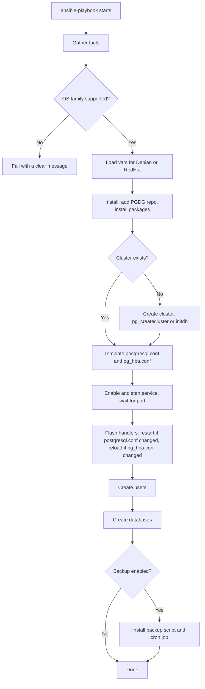

# PostgreSQL Ansible Role | Design Document

| Author | Created on | Version   | Last updated by | Last edited on |
| ------ | ---------- | --------- | --------------- | -------------- |
| Sahil  | 13-10-26   | version 1 | Sahil           | 13-10-26       |

## Introduction

This document describes the design of an Ansible role that installs and configures PostgreSQL on Linux servers. It covers what the role does, how it is laid out, how it runs end to end, how to use it, and how to operate and troubleshoot the database it builds.

This is the design deliverable. To check that the design works, a prototype of the role was built and run on two real servers (Ubuntu 24.04 and RHEL 9.8). The results of those runs are included in the Test Results section. Full implementation, hardening and wider platform testing follow in the next sprint.

## Purposes

- Give the team one reusable, repeatable way to set up PostgreSQL instead of installing it by hand on each server.
- Keep every setting (version, port, memory, users, databases, backups) in variables, so the same role fits different servers and environments.
- Produce the same result on every run, so the role can safely be re-run to confirm or restore the intended state.

## Key features

- Installs PostgreSQL from the official PostgreSQL (PGDG) repository, with the version chosen by a variable.
- Supports two OS families from one set of tasks: Debian/Ubuntu (apt) and RedHat (dnf).
- Creates the database cluster only when it does not already exist.
- Manages `postgresql.conf` and `pg_hba.conf` from templates, using a restart or a reload as appropriate.
- Creates database users and databases from variables.
- Secure defaults: SCRAM-SHA-256 password hashing, local-only listening, and passwords kept in Ansible Vault.
- Idempotent: a second run on a configured server changes nothing.
- Optional scheduled backup with retention.

## Getting Started

### Pre-requisites

| License Type            | Description                                                         | Commercial Use | Open Source |
| ----------------------- | ------------------------------------------------------------------- | -------------- | ----------- |
| PostgreSQL License      | Permissive license (similar to BSD/MIT) covering PostgreSQL itself. | Yes            | Yes         |
| GNU GPL v3              | License of Ansible.                                                 | Yes            | Yes         |

### Software Overview

| Software             | Version                              |
| -------------------- | ------------------------------------ |
| PostgreSQL           | 16 (default, set by `postgresql_version`) |
| ansible-core         | 2.15 or higher (control machine)     |
| community.postgresql | Latest (Ansible collection)          |
| Python 3 + psycopg2  | Installed on the target by the role  |

### Supported Platforms

| Status                          | Platforms                                                    |
| ------------------------------- | ------------------------------------------------------------ |
| Tested                          | Ubuntu 24.04, RHEL 9.8 (both x86_64)                         |
| Supported by design, not tested | Ubuntu 22.04, Debian 11/12, Rocky Linux / AlmaLinux 8 and 9  |
| Not supported                   | Amazon Linux (its version number breaks the repository URL), ARM servers on the RedHat path (repository URL is fixed to x86_64) |

### System Requirement

| Requirement             | Minimum Recommendation                                              |
| ----------------------- | ------------------------------------------------------------------- |
| Processor/Instance Type | Dual-Core / t3.medium instance                                      |
| RAM                     | 4 Gigabyte recommended (see the Troubleshooting note on small servers) |
| ROM(Disk Space)         | 10 Gigabyte or higher                                               |
| OS Required             | Ubuntu 24.04 or RHEL 9 (tested)                                     |

### Important Ports

| Ports | Description                                                                                                                    |
| ----- | ------------------------------------------------------------------------------------------------------------------------------ |
| 22    | SSH. Used by Ansible on the control machine to reach the target server.                                                        |
| 5432  | PostgreSQL. Listens on localhost only by default. Open it in the security group only if `postgresql_listen_addresses` is changed. |

## Dependencies

### Run-time Dependency

Installed on the target server by the role.

| Run-time Dependency        | Version | Description                                                     |
| -------------------------- | ------- | --------------------------------------------------------------- |
| PostgreSQL server          | 16      | The database server (`postgresql-16` or `postgresql16-server`). |
| PostgreSQL client          | 16      | The `psql` client and tools.                                    |
| python3-psycopg2           | Latest  | Lets Ansible's PostgreSQL modules talk to the database.         |
| acl                        | Latest  | Lets Ansible switch to the unprivileged `postgres` user.        |

### Other Dependency

| Other Dependency        | Version | Description                                                                 |
| ----------------------- | ------- | --------------------------------------------------------------------------- |
| ansible-core            | 2.15+   | Runs the playbook. Installed on the control machine.                        |
| community.postgresql    | Latest  | Ansible collection providing the user and database modules.                 |
| Ansible Vault           | Bundled | Encrypts the database password.                                             |
| PGDG repository + key   | n/a     | Official PostgreSQL package source, added by the role.                      |
| SSH key pair            | n/a     | Lets the control machine log in to each target server.                      |

## Role Design

### Directory Structure

```
postgresql/
├── defaults/main.yml      all overridable variables and their defaults
├── vars/
│   ├── Debian.yml         Debian/Ubuntu package names, paths, service name
│   └── RedHat.yml         RedHat-family package names, paths, service name
├── tasks/
│   ├── main.yml           entry point, runs the files below in order
│   ├── install.yml        adds the PGDG repository, installs packages
│   ├── initialize.yml     creates the database cluster if missing
│   ├── configure.yml      templates postgresql.conf and pg_hba.conf
│   ├── service.yml        enables and starts the service, waits for the port
│   ├── users.yml          creates database users
│   ├── databases.yml      creates databases
│   └── backup.yml         optional backup script and cron job
├── handlers/main.yml      restart and reload PostgreSQL
├── templates/
│   ├── postgresql.conf.j2
│   ├── pg_hba.conf.j2
│   └── pg_backup.sh.j2
├── meta/main.yml          role metadata and tested platforms
├── requirements.yml       required Ansible collections
└── examples/              sample playbook and inventory
```

- **defaults/** holds everything a user is expected to change. It has the lowest priority, so any value in a playbook, `group_vars` or `host_vars` overrides it.
- **vars/** holds values that differ per OS family and are internal to the role. The role loads the right file from the host's OS family, which is how one set of tasks serves both Ubuntu and RHEL.
- **tasks/** is split by purpose. `main.yml` only decides the order, and each step lives in its own file with its own tag.
- **handlers/** holds the restart and reload actions. They run only when a config file actually changed.
- **templates/** holds the files generated from variables.

### Flow Diagram



Step notes:

- Users are created before databases, because a database can be owned by one of the users.
- Handlers are flushed before the database steps, so the new configuration is live before the role connects to create users and databases.
- A restart is needed for `postgresql.conf` changes (port, listen address, memory). A reload is enough for `pg_hba.conf` changes.
- On Ubuntu the package creates the cluster itself, so the create step is skipped. On RHEL the role runs `initdb`.

### Design Decisions

- **One role, two OS families.** OS differences are kept in `vars/`, and the tasks use `when` conditions for the few steps that differ (repository setup, cluster creation).
- **Whole-file configuration.** The role writes the complete `postgresql.conf`, which makes the result predictable. Manual edits on the server are overwritten on the next run.
- **Native Ansible modules.** Installing, templating, service handling, users and databases all use modules that check state first, which is what makes re-runs safe.
- **Passwords never in the role.** Secrets come from Ansible Vault, and the users task uses `no_log` so passwords do not appear in output.

## Variables

| Variable                              | Default                  | Description                                                    |
| ------------------------------------- | ------------------------ | -------------------------------------------------------------- |
| `postgresql_version`                  | `"16"`                   | PostgreSQL major version to install.                           |
| `postgresql_port`                     | `5432`                   | Port PostgreSQL listens on.                                    |
| `postgresql_listen_addresses`         | `"localhost"`            | Addresses to listen on. `"*"` or an IP list enables remote access. |
| `postgresql_max_connections`          | `100`                    | Maximum client connections.                                    |
| `postgresql_password_encryption`      | `scram-sha-256`          | Password hashing method.                                       |
| `postgresql_shared_buffers`           | `256MB`                  | Shared memory for caching. Lower it on small servers.          |
| `postgresql_work_mem`                 | `4MB`                    | Memory per sort or hash operation.                             |
| `postgresql_maintenance_work_mem`     | `64MB`                   | Memory for maintenance tasks.                                  |
| `postgresql_effective_cache_size`     | `1GB`                    | Planner hint for available cache.                              |
| `postgresql_logging_collector`        | `"on"`                   | Enables PostgreSQL's own log files.                            |
| `postgresql_log_min_duration_statement` | `-1`                   | Logs queries slower than this many ms. `-1` disables it.       |
| `postgresql_extra_settings`           | `{}`                     | Extra `postgresql.conf` settings as key: value pairs.          |
| `postgresql_hba_entries`              | local + localhost rules  | List of `pg_hba.conf` rules (first match wins).                |
| `postgresql_users`                    | `[]`                     | Users to create: `name`, `password`, optional `role_attr_flags`, `state`. |
| `postgresql_databases`                | `[]`                     | Databases to create: `name`, optional `owner`, `encoding`, `state`. |
| `postgresql_backup_enabled`           | `false`                  | Turns on the scheduled backup.                                 |
| `postgresql_backup_dir`               | `/var/backups/postgresql`| Where backups are written.                                     |
| `postgresql_backup_hour` / `_minute`  | `"2"` / `"0"`            | Backup time of day.                                            |
| `postgresql_backup_retention_days`    | `7`                      | Backups older than this are deleted.                           |

## How to Setup/Install the Role

### Step-by-step Installation Instruction

1. Prepare a project folder on the control machine and place the role in a `roles/` folder.

```bash
mkdir ~/pg-project && cd ~/pg-project
mkdir roles
# copy or unzip the role so that it is at roles/postgresql/
```

2. Install ansible-core and the required collection.

```bash
pip install ansible-core
ansible-galaxy collection install -r roles/postgresql/requirements.yml
```

*[Screenshot: collection installed successfully]*

3. Create the inventory, one line per target server with its own unique name.

```ini
[db_servers]
db_ubuntu ansible_host=<IP> ansible_user=ubuntu   ansible_ssh_private_key_file=testing.pem ansible_pipelining=true
db_rhel   ansible_host=<IP> ansible_user=ec2-user ansible_ssh_private_key_file=testing.pem ansible_pipelining=true
```

The login user depends on the image: `ubuntu` for Ubuntu, `ec2-user` for RHEL, AlmaLinux and Amazon Linux, `rocky` for Rocky Linux, `admin` for Debian.

4. Store the database password in an encrypted file.

```bash
ansible-vault create vault.yml
```

Inside the file, add (using your own password):

```yaml
vault_appuser_password: "choose-a-strong-password"
```

The first prompt asks for a vault password. This is the password that locks the file and is separate from the database password.

5. Write the playbook.

```yaml
---
- name: Deploy PostgreSQL
  hosts: db_servers
  become: true
  vars_files:
    - vault.yml
  roles:
    - role: postgresql
      vars:
        postgresql_version: "16"
        postgresql_listen_addresses: "localhost"
        postgresql_users:
          - name: appuser
            password: "{{ vault_appuser_password }}"
        postgresql_databases:
          - name: appdb
            owner: appuser
        postgresql_backup_enabled: true
```

6. Run the playbook against all servers, or against one with `--limit`.

```bash
ansible-playbook -i inventory.ini playbook.yml --ask-vault-pass
ansible-playbook -i inventory.ini playbook.yml --ask-vault-pass --limit db_rhel
```

*[Screenshot: PLAY RECAP of the first run]*

7. Run it a second time. A configured server should report `changed=0`.

*[Screenshot: PLAY RECAP of the second run showing changed=0]*

### Configuration

- **Change a setting:** set the variable in the playbook, `group_vars` or `host_vars`, then re-run the playbook. Do not edit `postgresql.conf` on the server, because the next run overwrites it.
- **Per-server values:** add the variable to that server's inventory line, for example `postgresql_shared_buffers=128MB` for a small server.
- **Extra parameters:** use `postgresql_extra_settings`, for example `wal_level: replica`.
- **Remote access:** three changes are needed together. Set `postgresql_listen_addresses`, add a `host` rule for the client's network to `postgresql_hba_entries`, and open port 5432 to that network in the security group.
- **Tags:** run part of the role with `--tags postgresql_install`, `postgresql_configure`, `postgresql_users`, `postgresql_databases` or `postgresql_backup`.
- **Dry run:** `--check` shows planned changes without making them. Tasks can report `changed` in this mode without changing anything, and some steps are skipped, so a dry run on a new server does not prove anything.

## Test Results

The prototype role was run on two servers.

| Check                                   | Ubuntu 24.04                         | RHEL 9.8                              |
| --------------------------------------- | ------------------------------------ | ------------------------------------- |
| Role completes without failure          | Yes                                  | Yes                                   |
| Re-run result                           | `ok=18 changed=0 failed=0`           | `ok=16 changed=0 failed=0`            |
| Service active and enabled on boot      | Yes (`postgresql`)                   | Yes (`postgresql-16`)                 |
| Listens only on localhost               | Yes (127.0.0.1)                      | Yes (127.0.0.1 and ::1)               |
| Config files carry the managed header   | Yes                                  | Yes                                   |
| `appuser` and `appdb` created           | Yes                                  | Yes                                   |
| Password login as `appuser`             | Works                                | Works                                 |
| Backup script produces a dump           | Yes                                  | Yes                                   |
| Cron entry present (02:00)              | Yes                                  | Yes                                   |

Observed differences between the two:

- **Config location:** `/etc/postgresql/16/main/` on Ubuntu, `/var/lib/pgsql/16/data/` on RHEL.
- **Locale:** databases use `C.UTF-8` on Ubuntu and `en_US.UTF-8` on RHEL, following each OS default. The role does not set a locale.
- **Backup file permissions:** files are created with each OS's default permissions, and on RHEL they are readable by all users. The backup directory is mode `0750`, which keeps other users out.
- **Not tested:** the scheduled 02:00 backup run on RHEL (SELinux is enforcing there), restoring from a backup, and any other OS version.

## Maintenance

Follow these commands.

```bash
# For update (minor version updates), Ubuntu
sudo apt-get update && sudo apt-get install --only-upgrade postgresql-16
# For update (minor version updates), RHEL
sudo dnf update postgresql16-server

# To upgrade software major version
# Not handled by this role. Changing postgresql_version installs the new version
# beside the old one and does not migrate data. Use pg_upgrade, or dump and restore.

# For restart (Ubuntu / RHEL)
sudo systemctl restart postgresql
sudo systemctl restart postgresql-16
```

- **Configuration changes:** edit variables and re-run the playbook. It restarts or reloads PostgreSQL only if a file changed.
- **Adding users or databases:** add them to the lists and re-run the playbook.
- **Applying role updates:** re-run the playbook. Re-running is safe.

## Monitoring

After installation, confirm that PostgreSQL is working with these commands on the target server.

```bash
systemctl is-active postgresql          # postgresql-16 on RHEL
systemctl is-enabled postgresql
pg_isready
sudo ss -tlnp | grep 5432
sudo -u postgres psql -c '\du' -c '\l'
psql -h 127.0.0.1 -U appuser -d appdb -c "select current_user;"
```

Expected results:

| Check                | Expected result                                                 |
| -------------------- | --------------------------------------------------------------- |
| Service state        | `active` and `enabled`                                          |
| `pg_isready`         | `accepting connections`                                         |
| Listening socket     | `127.0.0.1:5432` (RHEL also shows `[::1]:5432`), nothing on `0.0.0.0` |
| Users and databases  | `appuser` and `appdb` present, `appdb` owned by `appuser`       |
| Password login       | Returns `appuser`                                               |

*[Screenshot: verification commands and their output]*

When something goes wrong, check the log files first. PostgreSQL's log collector is on, and by default writes to a `log` folder inside the data directory. Service-level messages are available with `journalctl -u postgresql` (`postgresql-16` on RHEL).

## Security

- Passwords are hashed with SCRAM-SHA-256, and the role sets this both in the configuration and when creating the RHEL cluster.
- PostgreSQL listens on localhost only by default.
- The password is held in Ansible Vault, and the users task hides its output with `no_log`.
- `pg_hba.conf` is owned by `postgres` with mode `0640`, which is why a normal user gets `Permission denied` when reading it without `sudo`. This is expected.
- Backup dumps contain password hashes. The backup directory is private to `postgres`, and dumps should not be shared or copied to places other users can read.

## Disaster Recovery

- **Backups:** when `postgresql_backup_enabled` is true, a cron job runs as the `postgres` user at 02:00 and runs `pg_dumpall` into `/var/backups/postgresql`, compressed with gzip. Files older than `postgresql_backup_retention_days` are deleted.
- **Restore:** decompress a backup and feed it to `psql` on a server with the same major version.

```bash
gunzip -c /var/backups/postgresql/pg_dumpall_<date>.sql.gz | sudo -u postgres psql postgres
```

The restore command is not tested yet and should be tried on a spare server before it is relied on.

- **Rebuild:** a lost server can be rebuilt by re-running the role on a new one, then restoring the latest backup.
- **Recommended practice:** copy backups off the server, for example to S3, because a backup stored only on the same server is lost with it. This is not part of the role yet.

## High Availability

High availability is not implemented in this version. The design leaves room for it:

- **Streaming replication** with one primary and one or more replicas. The role already allows the needed settings through `postgresql_extra_settings` (for example `wal_level` and `max_wal_senders`), a replication user through `postgresql_users` with the `REPLICATION` attribute, and replication rules through `postgresql_hba_entries`.
- **Replica setup** would add a task that runs `pg_basebackup` from the primary.
- **Automatic failover** would need an additional tool, and is outside this ticket.

## Troubleshooting

| Issue | Cause | Solution |
| ----- | ----- | -------- |
| `Host key verification failed` | The server's SSH fingerprint is missing or has changed, common with a new EC2 instance on a reused IP. | Run `ssh-keygen -R <IP>`, connect once manually and accept the key. For test servers, `ansible_ssh_common_args='-o StrictHostKeyChecking=accept-new'`. |
| `Permission denied (publickey...)` | Wrong login user (for example `ec2` instead of `ec2-user`) or wrong key. | Use the correct user for the image and run `chmod 400` on the key file. Test with a manual `ssh` first. |
| Wrong server gets configured, or a host is ignored | Two inventory lines share the same name, so the second overwrites the first. | Give every server a unique name, and use `ansible <host> -m command -a hostname` to confirm which machine a name points to. |
| `Failed to set permissions on the temporary files...` with `chmod: invalid mode: 'A+user:postgres...'` | The `acl` package is missing, so Ansible cannot hand temporary files to the `postgres` user. | Install `acl` (the role now does), or set `ansible_pipelining=true` in the inventory. |
| Tasks show `changed` but the server is unchanged | The playbook was run with `--check`. | Run it again without `--check`. `skipping` on the wait-for-port task is a clue that a run was a dry run. |
| `No output from dnf script`, `rc: -9` | The kernel's out-of-memory killer ended `dnf` on a small server (717 MB RAM with no swap in testing). | Add swap, or use an instance with more RAM. Lower `postgresql_shared_buffers` on small servers. |
| `Alias 'port' is deprecated` | The collection renamed the `port` parameter. | Use `login_port` (the role now does). |
| `INJECT_FACTS_AS_VARS ... deprecated` | Old-style fact names such as `ansible_os_family`. | Use `ansible_facts['os_family']` (the role now does). |
| `'vault_appuser_password' is undefined` | The vault file is not loaded, or the variable name does not match. | Add `vars_files: [vault.yml]` to the play and check the variable name. |
| `Attempting to decrypt but no vault secrets found` / `Decryption failed` | The vault password was not given, or is wrong. | Run with `--ask-vault-pass` and enter the password used to create the file. |
| `Permission denied` when reading `pg_hba.conf` | The file is `0640`, owned by `postgres`. This is expected. | Read it with `sudo`. |
| `Failed to restore initial working directory` when running the backup script by hand | The `postgres` user cannot enter your home directory. The warning is harmless. | `cd /tmp` first. The cron job is not affected. |
| Warning about `remote_tmp` being created with mode 0700 | Ansible created the temp directory for the `postgres` user. | Harmless, no action needed. |

## FAQs

- **Is this role free?**

  * Yes. PostgreSQL and Ansible are both open source.

- **Which operating systems does it work on?**

  * It was tested on Ubuntu 24.04 and RHEL 9.8. Other Debian-family and RedHat-family versions are supported by design but untested. Amazon Linux and ARM servers on the RedHat path are not supported.

- **Does re-running the role restart PostgreSQL?**

  * No. A restart or reload happens only when a config file actually changed.

- **Can I install a different PostgreSQL version?**

  * Yes, set `postgresql_version`. The role does not migrate data between major versions.

- **Why are there databases I did not create (`template0`, `template1`, `postgres`)?**

  * PostgreSQL creates them with every new cluster. `template1` is the default copy used by `CREATE DATABASE`, `template0` is a clean copy kept for restores and for databases with a different encoding, and `postgres` is a default database for admin tools. Do not edit or drop them.

- **Can I connect from another machine?**

  * Yes, but it needs three changes: `postgresql_listen_addresses`, a matching `pg_hba.conf` rule, and the security group. By default it accepts local connections only.

- **Is the role fully implemented?**

  * This document is the design. A prototype was built and tested on two servers to validate it. Full implementation and further testing follow in the next sprint.

## Contact Information

| Name  | Email address        |
| ----- | -------------------- |
| Sahil | `<your-email>`       |

## References

| Links                                                                                           | Descriptions                                                      |
| ----------------------------------------------------------------------------------------------- | ----------------------------------------------------------------- |
| <https://github.com/OT-MICROSERVICES/documentation-template/wiki/Software-Template>             | Document format followed from this template                       |
| <https://www.postgresql.org/docs/16/>                                                           | PostgreSQL 16 documentation                                       |
| <https://wiki.postgresql.org/wiki/Apt>                                                          | Official PostgreSQL apt repository (PGDG)                         |
| <https://yum.postgresql.org/>                                                                   | Official PostgreSQL yum/dnf repository (PGDG)                     |
| <https://docs.ansible.com/ansible/latest/playbook_guide/playbooks_reuse_roles.html>             | Ansible roles documentation                                       |
| <https://docs.ansible.com/ansible/latest/vault_guide/index.html>                                | Ansible Vault documentation                                       |
